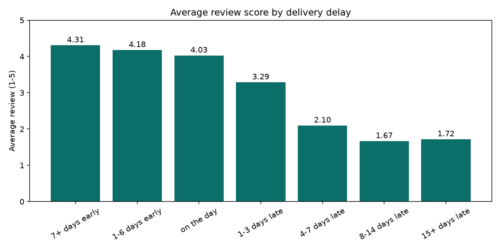
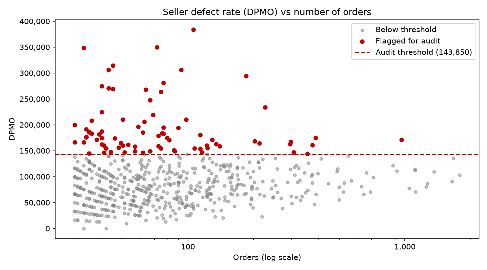
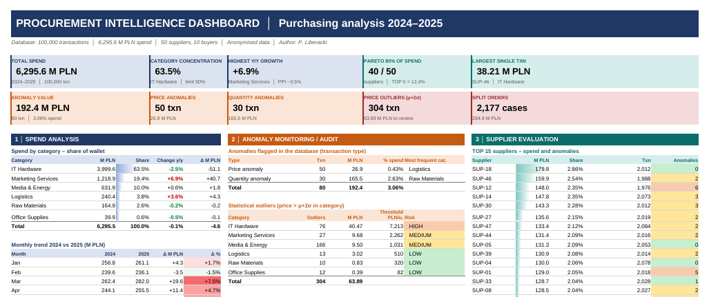
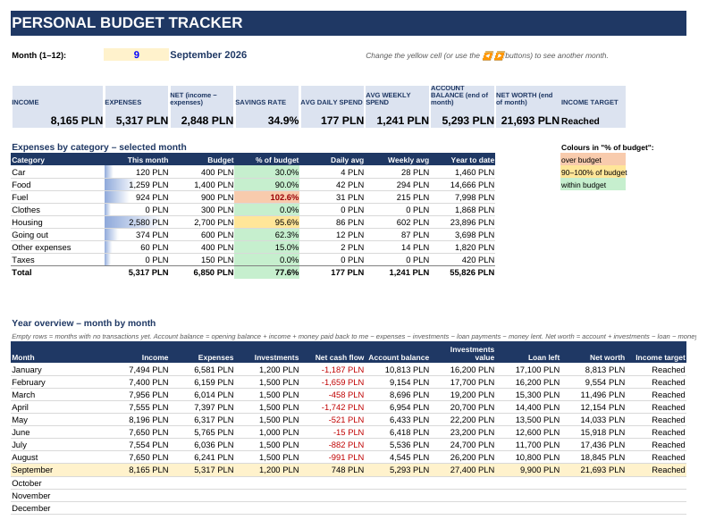
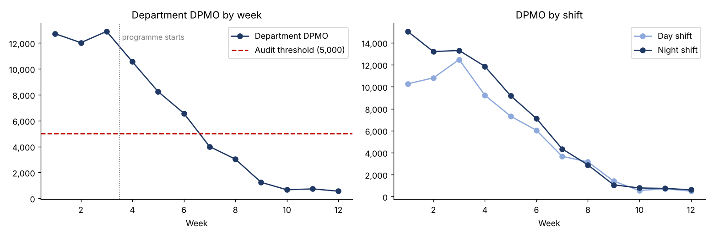
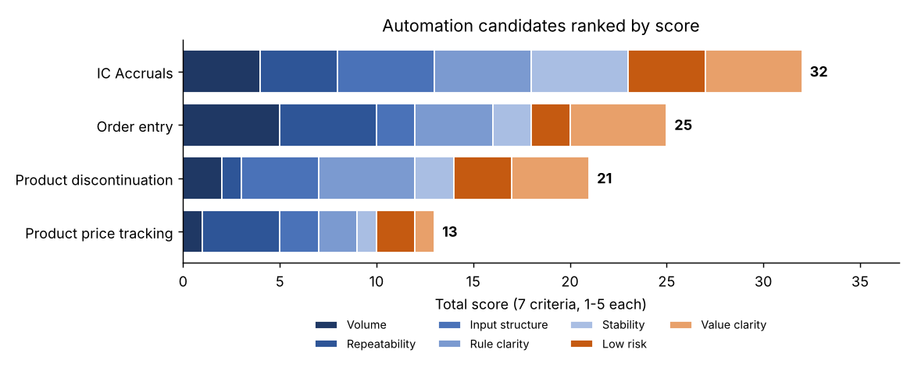
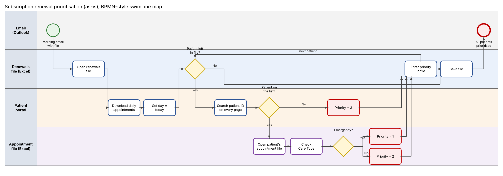
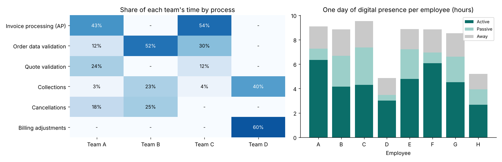

# Paweł Liberacki

Data and operations analyst based in Silesia, Poland. For two years I worked at Amazon as an Operations & Data Analyst / Area Manager in a customer returns operation: SQL on Redshift, dashboards in Power BI and QuickSight, Excel/VBA tools for the floor, and running shifts of up to 500 people.

This repo collects projects I built outside work. None of it uses company data: the datasets are public or synthetic, and case studies are retold with changed names and numbers.

## Projects

### 01 [Olist delivery KPIs and seller defect rate](https://github.com/pawelliberackicareer-arch/analytics-portfolio/tree/main/01-olist-delivery-kpi-python)
Python (pandas, matplotlib, openpyxl). 96k e-commerce orders: data quality checks, joins with row-count checks, delivery KPIs, how delays hit reviews, a DPMO-style seller audit list and an automatic Excel report.

 

### 02 [Procurement dashboard](https://github.com/pawelliberackicareer-arch/analytics-portfolio/tree/main/02-procurement-dashboard)
Excel. 100,000 purchase transactions: price outliers, split orders, supplier risk scorecard and a ranked list of red flags. Every number on the dashboard is a formula.

### 03 [Personal budget tracker](https://github.com/pawelliberackicareer-arch/analytics-portfolio/tree/main/03-budget-tracker-excel-vba)
Excel and VBA. A 500-column spending sheet rebuilt into a table-based tracker with budgets, net worth, a UserForm for entries and macros for reports and PDF export.

### 04 [Defect rate and DPMO](https://github.com/pawelliberackicareer-arch/analytics-portfolio/tree/main/04-defect-rate-dpmo)
SQL and Power BI. A 3-stage SQL pipeline on 458k synthetic units that finds associates who escalate too much, checks whether the escalations were right, scores them with DPMO and queues audits and corrective actions.

### 05 [Budget planner](https://github.com/pawelliberackicareer-arch/analytics-portfolio/tree/main/05-budget-planner-dashboard)
HTML and JavaScript. A web app for planning a year of personal finances in Poland: take-home pay after ZUS and tax, the PIT-0 limit for under-26s, net worth and tax reliefs.

### 06 [Automation prioritisation](https://github.com/pawelliberackicareer-arch/analytics-portfolio/tree/main/06-automation-prioritisation)
Excel and Power Query. Four processes scored on seven criteria to pick the best automation candidate, plus the design for the first one.

### 07 [Process map](https://github.com/pawelliberackicareer-arch/analytics-portfolio/tree/main/07-process-map)
BPMN. Swimlane map of a manual process and the places where it wastes time.

### 08 [Task-mining analysis](https://github.com/pawelliberackicareer-arch/analytics-portfolio/tree/main/08-task-mining-analysis)
What two productivity dashboards can and can't tell you about processes and teams.

Projects 06-08 are three parts of one case study for an automation analyst role.

## Contact

pawelliberackicareer@gmail.com | [LinkedIn](https://www.linkedin.com/in/pawel-liberacki/)
